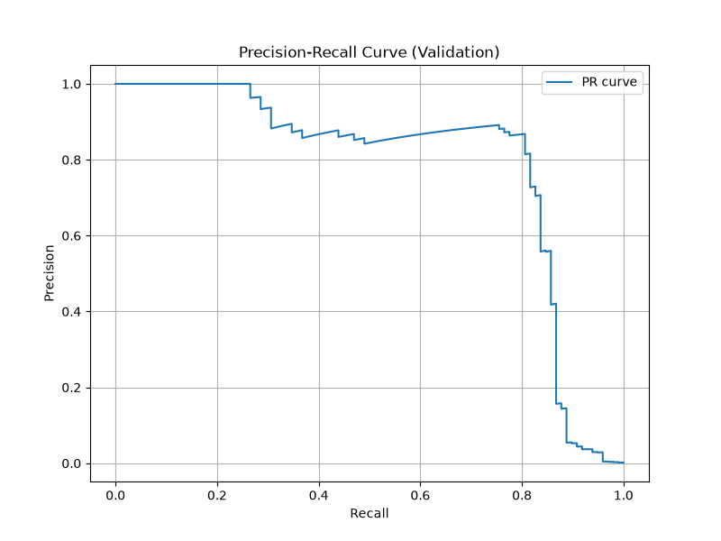
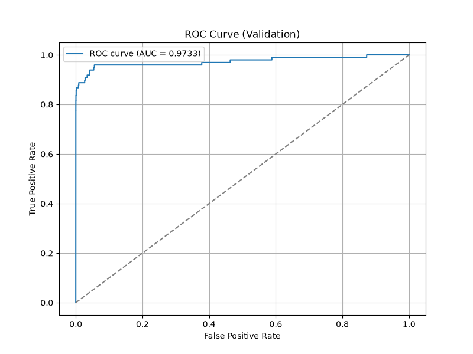

# ЛР2. Поріг рішення під асиметричну ціну помилок

**Виконав:** Герасименко Денис, група КМ-33

**Набір даних:** [Credit Card Fraud Detection (Kaggle)](https://www.kaggle.com/datasets/mlg-ulb/creditcardfraud).  

## Команди для запуску програми

**1. Підготовка середовища:**
```
uv venv --python 3.12
uv pip install -r requirements.txt
```

**2. Навчання моделі та збереження прогнозів:**
*(Виконується один раз. Скрипт вимагає вказати шлях до локального файлу `creditcard.csv` через параметр `--data`)*
```
uv run python lab2_starter.py --data creditcard.csv --out results
```

**3. Аналіз зі збережених прогнозів (без навчання):**
*(Скрипт використовує вже готові прогнози з теки `results/`)*
```
uv run python main.py
```

---

## 1. Підготовка даних та розбиття вибірки

Для побудови моделі ми беремо 29 вхідних ознак: V1-V28 та суму транзакції (`Amount`). Колонка `Time` ігнорується, а значення `Amount` додатково зберігаються в окремий масив, щоб потім проаналізувати природу помилок алгоритму.

На першому кроці ми відокремили 60% записів для навчальної вибірки. Решту 40% індексів було поділено рівно навпіл - так ми отримали валідаційну та тестову вибірки по 20%.

| Вибірка | Кіл-ть транзакцій | Шахрайські | Доля шахрайств |
| :--- | :--- | :--- | :--- |
| Train | 170 884 | 295 | 0.001726 |
| Validation | 56 961 | 98 | 0.001720 |
| Test | 56 962 | 99 | 0.001738 |

**Чому не можна розраховувати параметри стандартизації одразу для всіх даних?**

Якщо обчислити середнє значення та дисперсію до поділу датасету, інформація про масштаб ознак із тестової та валідаційної вибірок неминуче вплине на навчальні дані, що призведе до витоку даних. Оскільки тестовий набір має відігравати роль абсолютно нових транзакцій із реального світу, модель не повинна нічого про них знати на етапі підготовки.

## 2. Формули метрик

Транзакція класифікується як шахрайство, якщо $s_i \ge t$.

* **TP:** $y_i = 1$ та $s_i \ge t$
* **FP:** $y_i = 0$ та $s_i \ge t$
* **FN:** $y_i = 1$ та $s_i < t$
* **TN:** $y_i = 0$ та $s_i < t$

Вартість помилок:
$$C(t) = 10 \cdot FN(t) + FP(t)$$

Метрики:
$$Precision = \frac{TP}{TP + FP}, \quad Recall = TPR = \frac{TP}{TP + FN}, \quad FPR = \frac{FP}{FP + TN}$$

**ROC-AUC:** 0.973318




**Чому висока ROC-AUC не гарантує малої вартості помилок чи високої точності?**
Метрика ROC-AUC базується на $FPR = \frac{FP}{FP+TN}$. Оскільки TN у наборі сотні тисяч, велика кількість хибних тривог повністю розчиняється у знаменнику. Через це рівень FPR залишається близьким до нуля, і графік виглядає ідеально. Однак для бізнесу кожна хибна тривога є реальною вартістю, а $Precision$ при великій кількості FP різко падає. ROC-AUC просто не помічає хибні тривоги в умовах сильного дисбалансу класів.

### Вибір порога за мінімумом вартості C

Пошук здійснено за допомогою ефективного алгоритму сортування та кумулятивних сум за $O(n \log n)$. 
За рівної вартості обирається найбільший поріг. За допомогою алгоритму знайдено оптимальний поріг $t^* = 0.031194$.

| Правило на validation | Поріг | TP | FP | FN | TN | C |
| :--- | :--- | :--- | :--- | :--- | :--- | :--- |
| "Стандартний" поріг | 0.5 | 71 | 9 | 27 | 56 854 | 279 |
| $t^*$ | 0.031194 | 82 | 34 | 16 | 56 829 | 194 |
| Усі негативні | $+\infty$ | 0 | 0 | 98 | 56 863 | 980 |

## 3. Перевірка реалізації пошуку порога на малих наборах

Щоб довести коректність нашого швидкого алгоритму за $O(n \log n)$, ми порівняли його результати з класичним прямим перебором на трьох тестових наборах. Усі значення $TP, FP, FN, TN$ та вартість $C$ збіглися абсолютно точно для обох алгоритмів.

### Набір A
Цей набір має оцінки $s = [0.9, 0.7, 0.7, 0.4, 0.2, 0.1]$ та мітки $y = [0, 1, 0, 1, 0, 0]$.

| Поріг $t$ | TP | FP | FN | TN | C |
| :--- | :--- | :--- | :--- | :--- | :--- |
| $+\infty$ | 0 | 0 | 2 | 4 | 20 |
| 0.9 | 0 | 1 | 2 | 3 | 21 |
| 0.7 | 1 | 2 | 1 | 2 | 12 |
| **0.4 ($t^*$)**| **2** | **2** | **0** | **2** | **2** |
| 0.2 | 2 | 3 | 0 | 1 | 3 |
| 0.1 | 2 | 4 | 0 | 0 | 4 |

**Що перевіряє:** Коректну обробку однакових оцінок (двічі по 0.7). Алгоритм правильно згрупував їх як один кандидат на поріг, гарантуючи однозначність розрахунків матриці. Оптимальний поріг $t^* = 0.4$.

### Набір B
Цей набір має оцінки $s = [0.9, 0.6, 0.3]$ та мітки $y = [0, 0, 0]$.

| Поріг $t$ | TP | FP | FN | TN | C |
| :--- | :--- | :--- | :--- | :--- | :--- |
| **$+\infty$ ($t^*$)**| **0** | **0** | **0** | **3** | **0** |
| 0.9 | 0 | 1 | 0 | 2 | 1 |
| 0.6 | 0 | 2 | 0 | 1 | 2 |
| 0.3 | 0 | 3 | 0 | 0 | 3 |

**Що перевіряє:** Випадок екстремального дисбалансу, коли в наборі взагалі немає позитивних міток. Алгоритм не зламався, а логічно визначив, що найкращий поріг — це $+\infty$ (визнати всіх легітимними), що дало нульову вартість помилок.

### Набір C*
Цей набір має мітки $y = [1, 1, 0 (\times 10), 0]$ та оцінки $s = [0.8, 0.5 (\times 11), 0.2]$.

| Поріг $t$ | TP | FP | FN | TN | C ($10 \cdot FN + FP$) |
| :--- | :--- | :--- | :--- | :--- | :--- |
| $+\infty$ | 0 | 0 | 2 | 11 | 20 |
| **0.8 ($t^*$)**| **1** | **0** | **1** | **11** | **10** |
| 0.5 | 2 | 10 | 0 | 1 | 10 |
| 0.2 | 2 | 11 | 0 | 0 | 11 |

**Що перевіряє:** Ситуацію, коли мінімальна вартість (C = 10) виникає відразу на кількох різних порогах (0.8 та 0.5). Відповідно до логіки алгоритму, у разі нічиї беремо **найбільший поріг (t* = 0.8)**, оскільки він є найбезпечнішим і генерує менше хибних тривог.

---

## 4. Тестова оцінка та аналіз помилок

Поріг t* = 0.031194, знайдений на валідації, застосований до тестової вибірки.

| Поріг | TP | FP | FN | TN | C | precision | recall |
| :--- | :--- | :--- | :--- | :--- | :--- | :--- | :--- |
| 0.031194 | 80 | 43 | 19 | 56 820 | 233 | 0.6504 | 0.8081 |

*Примітка: Знаменники у метриках не були нульовими. Проте теоретично Precision не визначена, якщо алгоритм не робить жодного позитивного прогнозу (наприклад, при порозі +inf), а Recall не визначена, якщо у вибірці немає жодного шахрайства.*

### Перші 5 FP та FN

| Рядок | Тип | Мітка | Оцінка s | Відстань до t* | Amount |
| :--- | :--- | :--- | :--- | :--- | :--- |
| 460 | FP | 0 | 0.196159 | 0.164965 | 2.00 |
| 2961 | FP | 0 | 0.080961 | 0.049767 | 2.49 |
| 10783 | FP | 0 | 0.966327 | 0.935133 | 89.99 |
| 13405 | FP | 0 | 0.932032 | 0.900838 | 89.99 |
| 13617 | FP | 0 | 0.922762 | 0.891568 | 89.99 |
| 10497 | FN | 1 | 0.011464 | 0.019730 | 3.79 |
| 52521 | FN | 1 | 0.006373 | 0.024821 | 105.99 |
| 55401 | FN | 1 | 0.005642 | 0.025552 | 1.00 |
| 91671 | FN | 1 | 0.000500 | 0.030694 | 290.18 |
| 93486 | FN | 1 | 0.018352 | 0.012842 | 0.00 |

**Порівняння Amount і відстані оцінок від порога:**

* **Сума транзакції (Amount):** Чіткої закономірності немає. В обох типах помилок зустрічаються як дрібні транзакції, так і великі. Сума сама по собі не є вирішальним фактором для помилки.
* **Відстань до порога |s - t*|:** У хибних тривогах (FP) розкид величезний (відстань сягає 0.93), оскільки модель іноді з максимальною впевненістю блокує правильні операції. Натомість для пропущених шахрайств (FN) відстань є мікроскопічною (до 0.03). Це суто математичне обмеження: оскільки наш поріг дуже низький (t* ≈ 0.031), оцінки для FN затиснуті в діапазоні між нулем та цим порогом, тому фізично не можуть віддалитися від нього на значну величину.

**Висновок за 10 прикладами:**
Визначити справжню причину помилок за цими даними неможливо. Десять об'єктів - це занадто мала вибірка, до того ж вона не є випадковою, ми взяли просто перші рядки. Для повноцінного аналізу необхідно досліджувати приховані ознаки V1-V28 та порівнювати їх із правильно розпізнаними транзакціями TP та TN.

### Загальні висновки

| Вибірка | Поріг | TP | FP | FN | TN | Вартість (C) |
| :--- | :--- | :--- | :--- | :--- | :--- | :--- |
| Validation | 0.5 | 71 | 9 | 27 | 56 854 | 279 |
| Validation | 0.031194 | 82 | 34 | 16 | 56 829 | 194 |
| Test| 0.031194 | 80 | 43 | 19 | 56 820 | 233 |

### Загальні висновки

* Оскільки ми не перенавчали модель, зміна порога з 0.5 до $t^* \approx 0.031$ стала свідомим компромісом. Ми погодилися на більше кількість хибних тривог FP заради того, щоб не пропустити жодного можливого шахрая FN.
  * На валідації ми зловили на 11 шахраїв більше, а зменшення FN зекономило 110 одиниць вартості. Проте отримали на 25 хибних тривог більше. Чистий фінансовий виграш склав 85, оскільки вартість впала з 279 до 194.
  * На тесті тенденція підтвердилася: ми отримали на 9 шахраїв більше, але кількість хибних тривог зросла аж на 35. Чистий виграш склав 55, вартість впала з 288 до 233.
* Через такий зсув порога, повнота на тесті зросла до 0.808, проте точність впала до 0.650. Таке падіння точності є прийнятним через задану асиметричну ціну (штраф за пропуск у 10 разів вищий за хибну тривогу).

**Чому Validation не гарантує таких самих результатів на Test:**
  *  Поріг $t^*$ був знайдений як абсолютний мінімум для конкретного розподілу саме валідаційної вибірки. Нові тестові дані мають свій власний мікрошум, тому ідеальний поріг спрацював на них трохи гірше.
  *  У кожній вибірці є лише близько 100 шахраїв. Оскільки один пропуск коштує аж 10 одиниць, помилка моделі всього на 2-3 транзакції змінює фінальну вартість на десятки пунктів.

  ---

**Примітка** 
Під час виконання лабораторної роботи як допоміжний інструмент використовувалася мовна модель Gemini. ШІ застосовувався для форматування Markdown-таблиць, структурування тексту звіту `README.md`, а також для допомоги під час написання коду та його рефакторингу.
