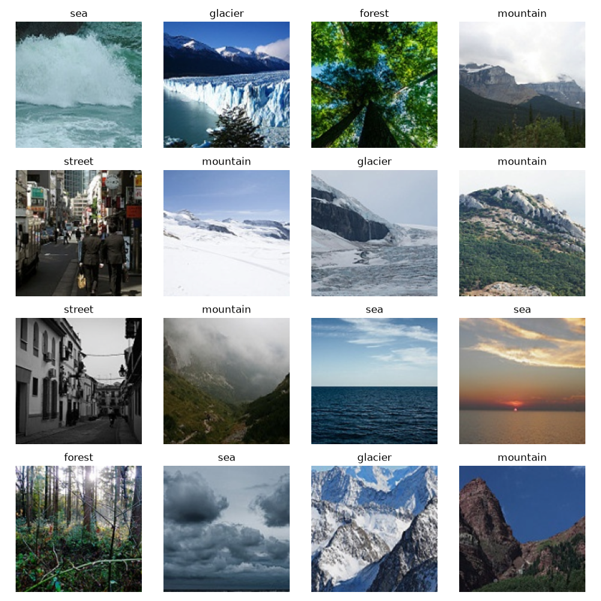
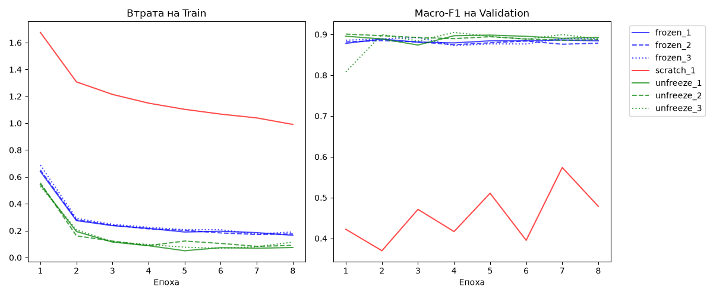
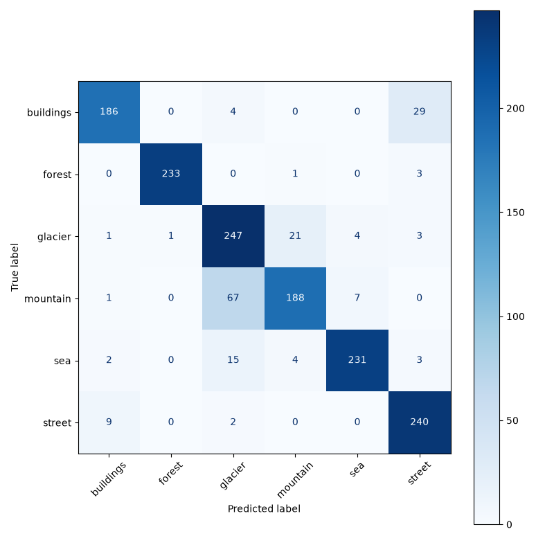
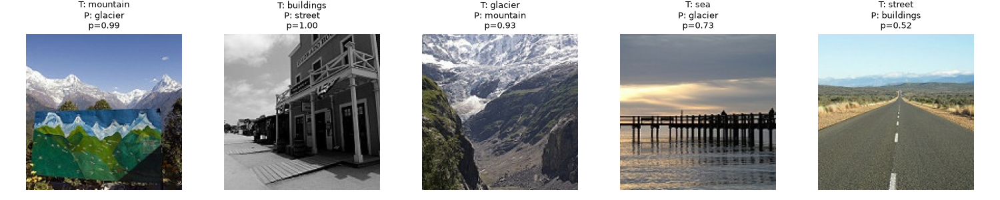

# ЛР3. Обчислювальний експеримент і трансферне навчання

**Виконав:** Герасименко Денис, група КМ-33

**Задача:** порівняти три режими навчання ResNet-18 (`scratch`, `frozen`, `unfreeze`) на малій вибірці Intel Image Classification (6 класів, 200 зображень на клас) за однакового бюджету в 304 кроки оптимізатора й відповісти, яку частину виграшу дають попередньо навчені ознаки, яку — донавчання кістяка, і чи більша кожна різниця за розкид між запусками.

**Набір даних:** Intel Image Classification (Kaggle). Класи в фіксованому порядку: `buildings, forest, glacier, mountain, sea, street`.

## Структура репозиторію

| Файл / тека | Призначення |
| :--- | :--- |
| `prepare_split.py` | Побудова `split.csv` за процедурою із завдання, контроль перетинів і таблиця контролю |
| `check_batch.py` | Рисунок першого train-пакета після перетворень (`batch_check.png`) |
| `check_loss.py` | Початкова втрата $L_0$ для scratch і frozen |
| `check_modes.py` | Параметри й групи оптимізатора, перевірка змін модулів, дослід із помилкою BN |
| `train_experiment.py` | Модель, режими, `set_train_mode`, цикл навчання, сім запусків, журнали, вибір, `lab3_model.pt` |
| `train_all.py` | **Команда навчання**: послідовно викликає п. 1–3 |
| `analyze.py` | **Команда аналізу**: хеш, таблиця, криві, ефекти, перевірка вибору, test, матриця плутанини, п'ять помилок |
| `split.csv` | Поділ даних (`file`, `label`, `part`) |
| `runs/<режим>_seed<зерно>/run.json` | Журнал запуску (налаштування, версії, хеші, втрата й F1 за епохами, час) |
| `runs/<режим>_seed<зерно>/val_logits.npy` | Логіти validation після 8-ї епохи, форма 1498 × 6 |
| `lab3_model.pt` | Ваги вибраного запуску (`state_dict`, `regime`, `seed`, `classes`, `img_size`) |
| `batch_check.png`, `curves.png`, `confusion_matrix.png`, `errors.png` | Рисунки до звіту |
| `requirements.txt` | Залежності із зафіксованими версіями |

---

## Команди для запуску

**1. Підготовка середовища**

```
uv venv --python 3.12
uv pip install -r requirements.txt
```

**2. Навчання** — поділ, перевірки п. 1–2, сім запусків, журнали, вибір і збереження `lab3_model.pt` (test не використовується):

```
uv run python train_all.py --data .
```

**3. Аналіз** — перевірка хешу `split.csv`, таблиця, криві, ефекти, перевірка вибору, одноразова тестова оцінка на CPU, матриця плутанини, п'ять помилок:

```
uv run python analyze.py --data .
```

---

## Позначення й формули

### Метрика якості

Для кожного класу $k$ (клас проти решти) за кількостями $TP_k$, $FP_k$, $FN_k$:

$$
F1_k = \frac{2\,TP_k}{2\,TP_k + FP_k + FN_k}
$$

Macro-F1 — середнє по шести класах:

$$
\text{macro-F1} = \frac{1}{6}\sum_{k=0}^{5} F1_k
$$

Підсумок запуску $F_{r,s}$ — macro-F1 на validation після 8-ї епохи для режиму $r$ і зерна $s$.

### Втрата

Втрата епохи — зважена за розміром пакета сума втрат пакетів (до кроку оптимізатора):

$$
\mathcal{L}_{\text{epoch}} = \sum_{b} \frac{|b|}{1200}\, L_b
$$

Еталон початкової втрати — модель із рівними ймовірностями шести класів:

$$
L_0^{\text{ref}} = \ln 6 \approx 1.7918
$$

### Середнє, розмах і поріг шуму

Для режиму $r \in \{\text{frozen}, \text{unfreeze}\}$ за трьома зернами:

$$
\bar F_r = \frac{1}{3}\sum_{s=1}^{3} F_{r,s}
\qquad\qquad
R_r = \max_s F_{r,s} - \min_s F_{r,s}
$$

Поріг шуму — більший із двох розмахів:

$$
R = \max\left(R_{\text{frozen}},\, R_{\text{unfreeze}}\right)
$$

### Ефекти

Ефект попереднього навчання та ефект розморожування:

$$
\Delta_{pre} = \bar F_{\text{frozen}} - F_{\text{scratch},1}
\qquad\qquad
\Delta_{unf} = \bar F_{\text{unfreeze}} - \bar F_{\text{frozen}}
$$

Їхня сума — повний виграш трансферу відносно навчання з нуля:

$$
\Delta_{pre} + \Delta_{unf} = \bar F_{\text{unfreeze}} - F_{\text{scratch},1}
$$

**Правило інтерпретації** (окремо для $\Delta_{pre}$ і $\Delta_{unf}$):

- якщо $|\Delta| \le R$ — різниця не відрізняється від розкиду, результату немає;
- якщо $|\Delta| > R$ — ефект вартий перевірки, але не доведений.

### Оцінка шуму за розмахом

Нехай $F_{r,s}$ за різних зерен мають стандартне відхилення $\sigma$. Для трьох нормально розподілених значень:

$$
\mathbb{E}[R_r] \approx 1.69\,\sigma
\qquad\Rightarrow\qquad
\hat\sigma \approx \frac{R}{1.69}
$$

Стандартна похибка різниці двох середніх із трьох запусків:

$$
SE(\Delta) = \sigma\sqrt{\frac{1}{3}+\frac{1}{3}} = \sqrt{\tfrac{2}{3}}\;\sigma \approx 0.82\,\sigma
$$

Отже, умова $|\Delta| > R \approx 1.69\,\sigma$ у середньому вимагає різниці понад дві стандартні похибки. Сам розмах трьох значень дуже неточний ($SD(R_r)\approx 0.89\,\sigma$), тож це груба оцінка шуму, а не довірчий інтервал.

### Стандартна похибка частки правильних відповідей

Для test з $n = 1502$ зображень і accuracy $p$:

$$
SE = \sqrt{\frac{p\,(1-p)}{n}}
$$

---
## 1. Перевірки до навчання

### 1.1 Поділ

- імена файлів кожного класу відсортовано як рядки;
- **train:** один `np.random.default_rng(0)` на всі класи по черзі, перші 200 файлів із перемішаного `idx`;
- **validation / test:** новий `default_rng(0)` для `seg_test`, перша половина (`idx[:cut]`, `cut = n // 2`) — validation, друга — test.

Формат клітинки: **кількість / сума числових імен файлів**.

| Клас | train | validation | test |
| :--- | :--- | :--- | :--- |
| buildings | 200 / 1 996 761 | 218 / 4 837 323 | 219 / 4 837 559 |
| forest | 200 / 2 032 625 | 237 / 5 276 962 | 237 / 5 291 326 |
| glacier | 200 / 2 183 923 | 276 / 6 135 652 | 277 / 6 157 250 |
| mountain | 200 / 1 950 345 | 262 / 5 789 535 | 263 / 5 849 765 |
| sea | 200 / 1 987 613 | 255 / 5 655 068 | 255 / 5 668 011 |
| street | 200 / 1 841 817 | 250 / 5 541 845 | 251 / 5 547 533 |
| **Разом** | **1200 / 11 993 084** | **1498 / 33 236 385** | **1502 / 33 351 444** |

**Усі 18 клітинок і підсумковий рядок збігаються з контрольною таблицею завдання.**

| Перетин частин (за іменами файлів) | Кількість |
| :--- | :-: |
| train ∩ validation | 0 |
| train ∩ test | 0 |
| validation ∩ test | 0 |

SHA-256 `split.csv` (однаковий у всіх семи журналах і збігається з поточним файлом):

```
148dad92de9a18670c177df9f8757aa6519fb0ea6d74a8ba723cfc4453f0a1bc
```

### 1.2 Пакет після перетворень

Перші 16 зображень першого train-пакета в тому вигляді, в якому їх отримує модель: після `RandomResizedCrop(160, scale=(0.7, 1.0))` і `RandomHorizontalFlip`, із оберненим нормуванням і міткою над кожним.



### 1.3 Початкова втрата

Модель побудовано за кроками 1–5 зі зерном 1. Втрату $L_0$ обчислено на першому пакеті train-завантажувача після `set_train_mode`, під `torch.no_grad()`, до жодного кроку оптимізатора. Порівняння з $\ln 6$:

| Режим | $L_0$ | $\ln 6$ | $L_0 - \ln 6$ |
| :--- | :-: | :-: | :-: |
| scratch | 2.0479 | 1.7918 | +0.2561 |
| frozen | 1.9244 | 1.7918 | +0.1326 |

**Пояснення відхилення.**

Значення $\ln 6$ дає лише модель, яка видає строго однакові логіти для всіх класів. Голова `Linear(512, 6)` зі стандартною ініціалізацією видає невеликі, але ненульові випадкові логіти, а ознаки на її вході мають немалий масштаб (вихід ReLU з глобальним усередненням). Тому логіти нерівні, а впевнена помилкова відповідь штрафується сильніше, ніж рівномірна, і втрата випадкової моделі в середньому трохи перевищує $\ln 6$.

## 2. Перевірка режимів навчання

### 2.1 Параметри

Загальна кількість параметрів моделі в усіх режимах — **11 179 590**.

| Режим | Навчаються (`requires_grad=True`) | Групи AdamW: параметрів, lr | Збіг з таблицею завдання |
| :--- | :-: | :--- | :-: |
| scratch | 11 179 590 | усі: 11 179 590, lr = 3·10⁻³ | так |
| frozen | 3 078 | `fc`: 3 078, lr = 3·10⁻³ | так |
| unfreeze | 8 396 806 | `fc`: 3 078, lr = 3·10⁻³; `layer4`: 8 393 728, lr = 3·10⁻⁴ | так |

Жоден параметр із `requires_grad=False` не потрапив у оптимізатор. Оптимізатор — `AdamW(weight_decay=1e-4)`, решта аргументів за замовчуванням.

### 2.2 Що змінюється за 5 кроків оптимізатора

Нова модель із зерном 1, копія повного `state_dict()`, `set_train_mode`, 5 кроків на перших 5 пакетах. Для кожного модуля верхнього рівня окремо порівняно параметри та ковзні статистики BN точно (`torch.equal`).

**Режим frozen**

| Модуль | Параметри змінилися | Ковзні статистики BN змінилися | Збігається з очікуваним |
| :--- | :-: | :-: | :-: |
| conv1 | ні | немає BN | так |
| bn1 | ні | ні | так |
| layer1 | ні | ні | так |
| layer2 | ні | ні | так |
| layer3 | ні | ні | так |
| layer4 | ні | ні | так |
| fc | так | немає BN | так |

**Режим unfreeze**

| Модуль | Параметри змінилися | Ковзні статистики BN змінилися | Збігається з очікуваним |
| :--- | :-: | :-: | :-: |
| conv1 | ні | немає BN | так |
| bn1 | ні | ні | так |
| layer1 | ні | ні | так |
| layer2 | ні | ні | так |
| layer3 | ні | ні | так |
| layer4 | так | так | так |
| fc | так | немає BN | так |

Усі рядки обох таблиць збігаються з очікуваним, тому далі переходимо до основного експерименту.

### 2.3 Дослід із навмисною помилкою 
**Прогноз**

- Параметри замороженого кістяка **не зміняться**: градієнти для них не рахуються, оптимізатор їх не оновлює.
- Ковзні статистики BN (`running_mean`, `running_var`, `num_batches_tracked`) у всіх BN-шарах кістяка **зміняться**, бо в режимі `train()` прямий прохід оновлює їх незалежно від градієнтів.
- На кривій втрати на train це майже непомітно: параметри ті самі, а в режимі навчання BN нормує за статистикою пакета, тож прямий прохід майже не залежить від `running_*`. Проблема проявиться лише на validation/test, де BN в `eval()` бере вже зіпсовані ковзні статистики.

**Результат.**

| Модуль | Параметри змінилися | Ковзні статистики BN змінилися | Збігається з очікуваним |
| :--- | :-: | :-: | :-: |
| conv1 | ні | немає BN | так |
| bn1 | ні | **так** | **ні** |
| layer1 | ні | **так** | **ні** |
| layer2 | ні | **так** | **ні** |
| layer3 | ні | **так** | **ні** |
| layer4 | ні | **так** | **ні** |
| fc | так | немає BN | так |

Максимальна абсолютна зміна в шарі `layer1.0.bn1` після 5 кроків:

| Величина | Макс. абсолютна зміна |
| :--- | :-: |
| `running_mean` | 0.0928 |
| `running_var` | 0.1203 |

Результат збігся з прогнозом: параметри не змінилися, а статистики BN «попливли» в усіх BN-модулях кістяка.

**Чому `requires_grad=False` не захищає ці значення.**

`running_mean` і `running_var` — це не параметри, а **буфери**. Вони оновлюються всередині прямого проходу BN-модуля в режимі `train()`, без участі autograd та оптимізатора:

$$
\text{running} \leftarrow (1-m)\,\text{running} + m\,\text{batch\_stat},\qquad m = 0.1
$$

Прапорець `requires_grad` стосується лише градієнтів параметрів. Захистити буфери може тільки режим `eval()` для модуля.

**Чому для `layer4` в unfreeze їхнє оновлення правильне.**

`layer4` у цьому режимі справді донавчається: його ваги змінюються, а отже, змінюється й розподіл активацій, який він видає. Ковзні статистики мають слідувати за цим новим розподілом (і за розподілом даних нової задачі). Інакше на validation/test BN нормував би за застарілими ImageNet-статистиками, які вже не відповідають змінюваним вагам. Тому `layer4` лишається в `train()`, а `conv1, bn1, layer1–layer3` — в `eval()`.

**Чому заморожені модулі мають бути в `eval()`.**

Якби вони були в `train()`, кожен пакет із 32 зображень маленького набору зсував би ковзні ImageNet-статистики кістяка. Голова навчалася б на ознаках, нормованих за статистикою пакета, а на оцінці BN використовував би вже змінені `running_*`, тобто ознаки на оцінці відрізнялися б від навчальних. Це тихо псує якість, хоча «заморожені» ваги формально не змінилися.

---

## 3. Сім запусків

8 епох × 38 кроків = **304 кроки** оптимізатора (38 = ⌈1200/32⌉, останній пакет епохи — 16 зображень).

Журнали зберігаються в `runs/<режим>_seed<зерно>/run.json` і містять зерно, усі налаштування, SHA-256 `split.csv`, версії Python/PyTorch/torchvision, пристрій, втрату train і macro-F1 validation за епохами, час навчання. Поруч лежать `val_logits.npy` (1498 × 6).

| # | Режим | Зерно | Втрата train, епоха 8 | macro-F1 validation, епоха 8 | Час навчання, с |
| :-: | :--- | :-: | :-: | :-: | :-: |
| 1 | scratch | 1 | 0.9906 | 0.4784 | 47.8 |
| 2 | frozen | 1 | 0.1655 | 0.8842 | 37.2 |
| 3 | frozen | 2 | 0.1757 | 0.8785 | 37.2 |
| 4 | frozen | 3 | 0.1896 | 0.8886 | 37.5 |
| 5 | unfreeze | 1 | 0.0747 | 0.8927 | 37.9 |
| 6 | unfreeze | 2 | 0.0903 | 0.8869 | 38.0 |
| 7 | unfreeze | 3 | 0.1148 | 0.8889 | 37.9 |

Орієнтир самоперевірки виконано: у frozen macro-F1 ≈ 0.88; у scratch помітно менше, але значно вище вгадування (≈ 1/6), тож це не ознака помилки.

**Криві семи запусків** (ліворуч — втрата на train, праворуч — macro-F1 на validation, спільні осі):



## 4. Розклад ефектів

Формули — у розділі [«Позначення й формули»](#позначення-й-формули).

### 4.1 Числа

Підстановка в формули для $\bar F_r$, $R_r$, $R$:

| Режим | $F_{r,1}$ | $F_{r,2}$ | $F_{r,3}$ | $\bar F_r$ | $R_r$ |
| :--- | :-: | :-: | :-: | :-: | :-: |
| scratch | 0.4784 | — | — | 0.4784 | — |
| frozen | 0.8842 | 0.8785 | 0.8886 | 0.8838 | 0.0101 |
| unfreeze | 0.8927 | 0.8869 | 0.8889 | 0.8895 | 0.0058 |

Поріг шуму: $R = \max(0.0101,\; 0.0058) = 0.0101$.

Ефекти:

$$
\Delta_{pre} = 0.8838 - 0.4784 = +0.4054
$$

$$
\Delta_{unf} = 0.8895 - 0.8838 = +0.0057
$$

$$
\Delta_{pre} + \Delta_{unf} = +0.4111 = 0.8895 - 0.4784
$$

Сума збігається з $\bar F_{\text{unfreeze}} - F_{\text{scratch},1}$.

### 4.2 Застосування правила

| Ефект | Значення | $\lvert\Delta\rvert / R$ | Вердикт |
| :--- | :-: | :-: | :--- |
| $\Delta_{pre}$ | +0.4054 | ≈ 40 | $\lvert\Delta\rvert > R$: ефект вартий перевірки, але не доведений |
| $\Delta_{unf}$ | +0.0057 | ≈ 0.56 | $\lvert\Delta\rvert \le R$: **різниця не відрізняється від розкиду, результату немає** |

### 4.3 Стандартна похибка (грубо)

За розмахом $R = 0.0101$:

$$
\hat\sigma \approx \frac{0.0101}{1.69} \approx 0.0060
$$

$$
SE(\Delta) \approx 0.82 \cdot 0.0060 \approx 0.0049
$$

Отже, $\Delta_{unf} = 0.0057$ трохи більша за одну стандартну похибку різниці ($0.0057 > 0.0049$), але менша за дві ($\approx 0.0098$) і менша за $R$. Це груба оцінка шуму за трьома значеннями, а не довірчий інтервал.

### 4.4 Що саме змінює зерно і чому розкид frozen та unfreeze різний

У `run_training` зерно ставиться в `build_model` (`torch.manual_seed(seed)`) **після** створення завантажувачів. Перемішування train і випадкові аугментації беруть випадковість із глобального генератора PyTorch (`num_workers=0`, власного `generator` немає). Тому зерно змінює одразу три речі:

| Що змінює зерно | Режими, яких це стосується |
| :--- | :--- |
| Ініціалізація голови `fc` (`Linear(512, 6)`) | усі; у scratch — ініціалізація всієї мережі |
| Порядок пакетів (склад кожного з 38 пакетів) | усі |
| Випадкові аугментації (положення кропу, віддзеркалення) | усі |

Ваги кістяка у frozen і unfreeze від зерна не залежать (завжди ImageNet).

У **frozen** навчається лише лінійна голова з 3 078 параметрів над незмінними ознаками, тобто задача близька до опуклої, і різні зерна мають сходитися до схожого розв'язку ($R_{\text{frozen}} = 0.0101$).

У **unfreeze** додатково навчається `layer4` (8.39 млн параметрів), тож траєкторія оптимізації могла б сильніше залежати від порядку пакетів та аугментацій. Проте в цих запусках розкид навіть менший ($R_{\text{unfreeze}} = 0.0058$). Розмах трьох значень — дуже неточна оцінка, тож різниця 0.0101 проти 0.0058 може бути випадковою, і про різний розкид режимів за цими даними певного сказати не можна.

### 4.5 Чому $R$ (запуски 2–7) не характеризує розкид запуску 1 і чи змінює це висновок про $\Delta_{pre}$

$R$ виміряно лише на frozen і unfreeze (попередньо навчені ваги, стабільна оптимізація). Scratch — інша система: усі ваги випадкові, оптимізація нестабільна, а BN у режимі `eval()` на validation користується ковзними статистиками, які за 304 кроки ще не встигають стабілізуватися.

Крива scratch (macro-F1 на validation за епохами 1–8):

| Епоха | 1 | 2 | 3 | 4 | 5 | 6 | 7 | 8 |
| :--- | :-: | :-: | :-: | :-: | :-: | :-: | :-: | :-: |
| macro-F1 | 0.4222 | 0.3697 | 0.4710 | 0.4167 | 0.5106 | 0.3952 | 0.5737 | 0.4784 |

Між сусідніми епохами macro-F1 стрибає до 0.18 (епохи 6 → 7: 0.3952 → 0.5737), тобто майже в 18 разів більше за $R = 0.0101$. Шум значення $F_{\text{scratch},1}$ невідомий (запуск один) і, судячи з кривої, значно більший за $R$.

**Чи змінює це висновок?**

- **Напрям — ні.** Навіть найкраща епоха scratch (0.5737) далеко нижча за frozen (0.8838); увесь діапазон кривої scratch (0.3697–0.5737, ширина 0.204) лежить нижче за будь-яке значення frozen/unfreeze.
- **Величина — так.** $\Delta_{pre} = +0.4054$ взято з епохи 8, а за найкращою епохою scratch різниця була б ≈ +0.31, за найгіршою ≈ +0.51. Чесніше казати «напрям однозначно додатний, величина — від ≈ 0.31 до ≈ 0.51 залежно від епохи».

Саме тому за правилом вердикт — «вартий перевірки, але не доведений»: для доведення потрібні кілька зерен scratch.

### 4.6 Чи однаковий бюджет режимів за часом

**Ні.** Бюджет однаковий лише за кількістю кроків оптимізатора (304) та епох, але не за часом:

| Режим | Середній час, с | Відносно frozen |
| :--- | :-: | :-: |
| frozen | ≈ 37.3 | 1.00× |
| unfreeze | ≈ 37.9 | ≈ 1.02× |
| scratch | 47.8 | ≈ 1.28× |

Причина: у scratch градієнти рахуються через усю мережу (11.2 млн параметрів оптимізатора проти 3 тис. у frozen). Різниця між frozen і unfreeze майже зникла, бо на GPU час визначається переважно читанням і декодуванням JPEG (`num_workers=0`) та валідацією після кожної епохи.

---

## 5. Вибір конфігурації і тестова оцінка

### 5.1 Вибір (лише за validation)

| Режим | $\bar F_r$ |
| :--- | :-: |
| scratch | 0.4784 |
| frozen | 0.8838 |
| **unfreeze** | **0.8895** |

Найкращий режим — unfreeze. Серед його запусків найбільший $F_{r,s}$ у **seed 1** (0.8927). Його ваги збережено як `lab3_model.pt` (ключі `state_dict`, `regime`, `seed`, `classes`, `img_size = 160`). Команда аналізу підтвердила, що файл відповідає правилу вибору за збереженими журналами: **«Вибір збігається з правилом: True»**.

> **Увага:** $|\Delta_{unf}| = 0.0057 \le R = 0.0101$, тож вибір між frozen і unfreeze **визначив шум**, а не реальна перевага режиму.

### 5.2 Тестова оцінка (один раз, у команді аналізу, на CPU)

**macro-F1 на test = 0.8853.**

Матриця плутанини (рядки — справжній клас, стовпці — передбачений):

| | buildings | forest | glacier | mountain | sea | street |
| :--- | :-: | :-: | :-: | :-: | :-: | :-: |
| **buildings** | 186 | 0 | 4 | 0 | 0 | 29 |
| **forest** | 0 | 233 | 0 | 1 | 0 | 3 |
| **glacier** | 1 | 1 | 247 | 21 | 4 | 3 |
| **mountain** | 1 | 0 | 67 | 188 | 7 | 0 |
| **sea** | 2 | 0 | 15 | 4 | 231 | 3 |
| **street** | 9 | 0 | 2 | 0 | 0 | 240 |



Розрахунок macro-F1 за формулою з розділу «Позначення й формули» (значення $TP_k$, $FP_k$, $FN_k$ — з матриці вище: діагональ, сума стовпця мінус діагональ, сума рядка мінус діагональ):

| Клас | $TP_k$ | $FP_k$ | $FN_k$ | $F1_k$ |
| :--- | :-: | :-: | :-: | :-: |
| buildings | 186 | 13 | 33 | 0.8900 |
| forest | 233 | 1 | 4 | 0.9894 |
| glacier | 247 | 88 | 30 | 0.8072 |
| mountain | 188 | 26 | 75 | 0.7883 |
| sea | 231 | 11 | 24 | 0.9296 |
| street | 240 | 38 | 11 | 0.9074 |

$$
\text{macro-F1}_{\text{test}} = \frac{0.8900 + 0.9894 + 0.8072 + 0.7883 + 0.9296 + 0.9074}{6} = 0.8853
$$

Найслабші класи — mountain і glacier, що узгоджується з матрицею.

### 5.3 Validation проти test і зміщення вибору

Правильних відповідей 1325 із 1502, тобто accuracy:

$$
p = \frac{1325}{1502} \approx 0.8822
$$

Стандартна похибка частки правильних відповідей:

$$
SE = \sqrt{\frac{0.8822\,(1 - 0.8822)}{1502}} \approx 0.0083
$$

| Величина | Значення |
| :--- | :-: |
| macro-F1 вибраного запуску, validation | 0.8927 |
| macro-F1 вибраного запуску, test | 0.8853 |
| Різниця validation − test | +0.0074 |
| $SE$ (порядок шуму скінченної вибірки) | 0.0083 |

**Чи видно зміщення?**

Знак різниці (+0.0074) відповідає оптимістичному зміщенню: ми взяли найкращий із трьох запусків, і його validation-число завищене порівняно із середнім режиму (0.8927 проти $\bar F_{\text{unfreeze}} = 0.8895$, тобто +0.003). Але величина різниці validation − test (0.0074) менша за $SE \approx 0.0083$ (≈ 0.9 $SE$). За цими числами зміщення не відрізнити від шуму скінченної вибірки.

**Чому зміщення може бути непомітним або мати протилежний знак.**

1. Оптимізм від вибору «найкращого з трьох» має порядок десятих відсотка (≈ $0.9\sigma$ при $\sigma \approx 0.006$, тобто ≈ 0.005), що менше за статистичну похибку test (≈ 0.008).
2. Validation і test — дві випадкові половини одного `seg_test`. Обидві оцінки шумні, і на конкретних 1502 зображеннях test міг «випасти» легшим, тоді test перевищить validation (протилежний знак).
3. Зміщення — це математичне сподівання, а одна реалізація може відхилитися в будь-який бік.

$SE$ тут — лише порядок величини (формула для accuracy, застосована до macro-F1).

### 5.4 П'ять характерних помилок

Найчастіші позадіагональні пари з матриці; для кожної взято перший за іменем (відсортованим як рядок) файл test із такою помилкою.

| Файл | Справжній клас | Передбачений клас | Імовірність передбаченого класу | Кількість таких помилок у test |
| :--- | :--- | :--- | :-: | :-: |
| 20071.jpg | mountain | glacier | 0.9924 | 67 |
| 20246.jpg | buildings | street | 0.9998 | 29 |
| 20179.jpg | glacier | mountain | 0.9269 | 21 |
| 20267.jpg | sea | glacier | 0.7290 | 15 |
| 20737.jpg | street | buildings | 0.5229 | 9 |



**Категорії помилок.**

| Файл | Категорія | Пояснення |
| :--- | :--- | :--- |
| 20071.jpg | сцена містить обидва класи | засніжені вершини з льодовиковим покривом; у нижній частині кадру вставлена зелена гірська графіка (схоже на колаж), тож кадр неоднозначний, а впевненість моделі 0.99 |
| 20246.jpg | сцена містить обидва класи | на кадрі вулиця з будівлями; упевненість 1.00 натякає на спірну мітку, але кадр не є однозначним |
| 20179.jpg | сцена містить обидва класи | льодовик лежить на гірському схилі, модель обрала сусідній клас |
| 20267.jpg | помилка моделі на однозначному зображенні | пірс над водою на заході сонця: льоду й гір немає, мітка sea очевидна, а модель обрала glacier (p = 0.73) |
| 20737.jpg | помилка моделі на однозначному зображенні | порожня пряма дорога серед відкритої місцевості без будівель; мітка street очевидна, модель помилилась з малою впевненістю (p = 0.52) |

**Плутанина glacier ↔ mountain** (67 + 21 = 88 із 177 помилок, ≈ 50 %) — це **властивість набору**: обидва класи часто містять засніжені гори, межа між ними розмита, і сама розмітка неоднозначна. Друга за величиною плутанина buildings ↔ street (29 + 9 = 38) має схожу природу: вулиці обрамлені будівлями.

---

## 6. Висновок

### 6.1 Попереднє навчання ($\Delta_{pre}$)

| | |
| :--- | :--- |
| **Напрям** | додатний: попередньо навчені ознаки значно покращують macro-F1 на validation |
| **Величина** | $\Delta_{pre} = +0.4054$ (з 0.4784 у scratch до 0.8838 у frozen), тобто ≈ 41 пункт macro-F1 |
| **Відношення до розкиду** | $\Delta_{pre} / R = 0.4054 / 0.0101 \approx 40$, тобто $\Delta_{pre} \gg R$ |
| **Вердикт за правилом** | $\lvert\Delta_{pre}\rvert > R$: вартий перевірки, але не доведений |

Вердикт обережний, бо scratch запущено лише один раз, а його крива дуже нестабільна (епохи 6 → 7: 0.3952 → 0.5737). Навіть за найкращою епохою scratch (0.5737) різниця лишається ≈ +0.31 ≫ $R$, тож напрям надійний, а точна величина — ні.

### 6.2 Розморожування кістяка ($\Delta_{unf}$)

| | |
| :--- | :--- |
| **Напрям** | формально додатний |
| **Величина** | $\Delta_{unf} = +0.0057$ (0.57 пункту macro-F1; $\bar F$ зросло з 0.8838 до 0.8895) |
| **Відношення до розкиду** | $\Delta_{unf} / R = 0.0057 / 0.0101 \approx 0.56$, тобто $\lvert\Delta_{unf}\rvert \le R$ |
| **Вердикт за правилом** | різниця не відрізняється від розкиду: **результату немає** |

Втрата на train у unfreeze помітно менша (≈ 0.07–0.11 проти ≈ 0.17–0.19 у frozen), тобто мережа краще підганяється під train, але це не дає помітної переваги на validation (ознака перенавчання на 1200 зображеннях). За часом unfreeze майже не відрізняється від frozen (≈ 1.02×).

### 6.3 Застереження про бюджет

Обидва ефекти виміряно за конкретного бюджету — 304 кроки оптимізатора (8 епох). З довшим навчанням scratch міг би скоротити відставання, тож $\Delta_{pre}$ — це ефект за малого бюджету, а не незмінна константа.

### 6.4 Тест

macro-F1 вибраного запуску на test дорівнює 0.8853 (validation 0.8927, різниця +0.0074 за $SE \approx 0.0083$): оцінка узгоджена з validation, розрив у межах шуму вибірки.

### 6.5 Рекомендація для нової задачі з 200 зображеннями на клас

**frozen**: він дав практично таку саму якість, як unfreeze ($\lvert\Delta_{unf}\rvert \le R$), навчає лише 3 078 параметрів і не програє за часом (≈ 37.3 с проти ≈ 37.9 с у unfreeze та ≈ 47.8 с у scratch). До unfreeze варто повертатися лише тоді, коли з'являться дані й бюджет, щоб довести виграш повторними зернами.

---

## Відхилення та примітки

| Пункт | Опис |
| :--- | :--- |
| Пристрій | Навчання виконано на GPU NVIDIA GeForce GTX 1660 SUPER (CUDA, PyTorch 2.11.0+cu128, torchvision 0.26.0+cu128); тест — на CPU, як і вимагається |
| Відтворюваність | Окремі значення macro-F1 і $L_0$ можуть відрізнятися на іншому обладнанні та версіях бібліотек; висновки за збереженими журналами лишаються чинними. Тестові числа в README узято з виводу `analyze.py` |

### Використання інструментів

Під час виконання роботи як допоміжний інструмент використовувалися LLM Claude та Gemini